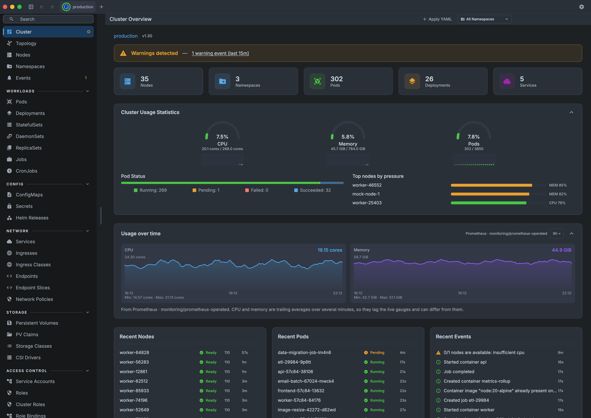

# KubeKubeDashDash

A desktop Kubernetes dashboard for macOS, Windows and Linux. It connects to your clusters through your local kubeconfig and lets you browse resources across several clusters at once, stream logs, open a shell into a pod, chart usage over time, and run common operational actions (scale, restart, cordon, drain, evict, trigger…) without hand-writing kubectl commands.

It is a browse-and-operate tool rather than an authoring tool: every write is a targeted action that confirms first, and YAML edits go through a line diff and a server-side dry run before anything is written.



**Website:** https://beytullah-gunduz.github.io/kubekubedashdash/

## Install

Download the installer for your system from the [latest release](https://github.com/beytullah-gunduz/kubekubedashdash/releases/latest): macOS (Apple Silicon `.dmg`), Windows (`.msi`) or Linux (amd64 `.deb`). Each one bundles its own Java runtime.

On an Apple Silicon Mac you can install it with [Homebrew](https://brew.sh) instead, and `brew upgrade` then keeps it up to date:

```bash
brew install --cask beytullah-gunduz/tap/kubekubedashdash
```

Keep the `beytullah-gunduz/tap/` prefix: Homebrew trusts a third-party cask only when you name it in full. If you installed the DMG before, delete `/Applications/KubeKubeDashDash.app` first, because Homebrew won't replace it. Your settings are kept.

The app isn't notarized yet, so macOS blocks its first launch, and again after each Homebrew upgrade. Open it once, then click **Open Anyway** in System Settings → Privacy & Security.

## Requirements

- A kubeconfig (`~/.kube/config` or `$KUBECONFIG`) with at least one cluster you can reach — or none, to try the demo cluster
- The cloud CLI your clusters authenticate with: **AWS CLI** for EKS, **Google Cloud SDK** with `gke-gcloud-auth-plugin` for GKE, **kubelogin** or **Azure CLI** for AKS
- Optional: a **Metrics Server** for live CPU and memory usage, and **Google Cloud Managed Service for Prometheus** or a **Prometheus** in the cluster for usage history

The app checks these at startup and says what is missing. It can also find your EKS and GKE clusters and add them to your kubeconfig.

**No cluster handy?** Pick **Demo Cluster** in the cluster picker: a built-in simulator with nodes, pods, workloads, CRDs, Helm releases, live metrics and events.

## Highlights

- **Several clusters at once** — one tab per cluster, several windows, and an [All Clusters view](GUIDE.md#all-clusters-view) with a fleet usage strip and event triage across clusters
- **Every common resource kind**, plus any [CRD](GUIDE.md#custom-resources-crds) and read-only [Helm releases](GUIDE.md#helm-releases-read-only), in live tables you can sort, filter and select from
- **See why a pod fails** — exit codes, OOMKills, scheduler reasons and recent warnings [right in the pod panel](GUIDE.md#pods)
- **Usage over time** — [CPU, memory, network and throttling charts](GUIDE.md#usage-and-metrics-history) for pods, Deployments, Jobs, CronJobs, Spark applications and namespaces, from Prometheus
- **Targeted actions** — [scale, restart, cordon, drain, evict, trigger, delete](GUIDE.md#resource-actions), one at a time or [in bulk](GUIDE.md#bulk-actions), with Undo where it applies
- **Safe YAML edits** — [diff and server dry run](GUIDE.md#editing-yaml-and-applying-manifests) before every write; Secrets stay masked until you reveal them
- **Logs and shells** — [log tabs](GUIDE.md#logs) with filters, stern-style namespace tails and log capture; an [interactive shell](GUIDE.md#pod-shell) and [port forwarding](GUIDE.md#port-forwarding)
- **Keyboard-first** — a [command palette](GUIDE.md#command-palette) (<kbd>⌘K</kbd> / <kbd>Ctrl+K</kbd>) to jump anywhere or run an action, and [shortcuts](GUIDE.md#keyboard-shortcuts) for the rest
- **Your look** — light, dark, a Retro style, high-contrast and editor palettes, colour-blind-safe status colours, UI zoom ([settings](GUIDE.md#settings-and-appearance))
- **An MCP server** for AI assistants — opt-in, [read-only](GUIDE.md#mcp-server), localhost by default

## Documentation

- [User guide](GUIDE.md) — every screen and action, settings, shortcuts, [limitations](GUIDE.md#limitations) and [troubleshooting](GUIDE.md#troubleshooting)
- [Contributing](CONTRIBUTING.md) — build from source, tests, packaging, CI
- [Credits](CREDITS.md)

## License

MIT
